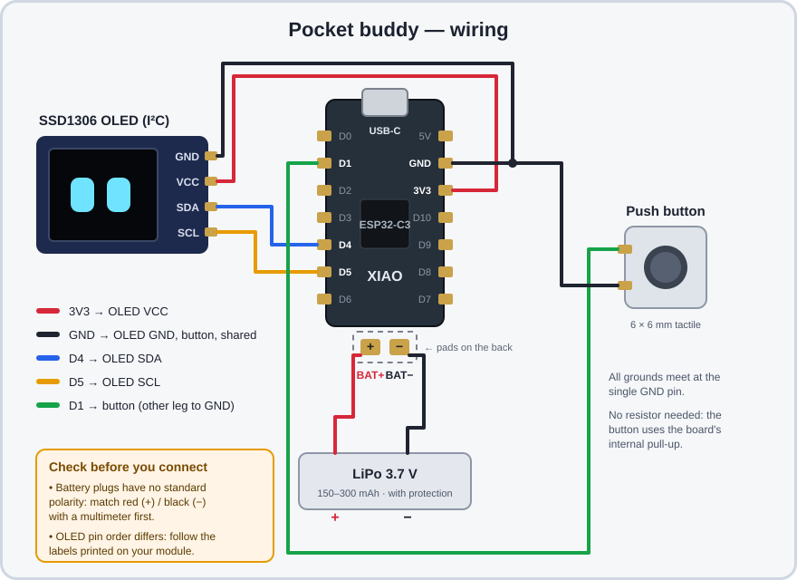

# 11 · Pocket buddy (tiny and portable)

A desk buddy does not have to sit on a desk. This chapter is a small, stand-alone build: a **keychain-sized robot with an animated face, one button and a rechargeable battery** — a handful of parts, one evening, no servos and no PC needed.

It trades features for size on purpose. It blinks, looks around, changes mood when you press the button, gets sleepy when you ignore it, and then goes to sleep to save the battery. That is the whole personality, and it is surprisingly charming.

> **Note:** This chapter was written from the board and library documentation and has not yet been tested on a physical build. The sketch is short and standard, but if you build it and something differs, please [open an issue](https://github.com/Ale-Studios/desk-buddy-guide/issues) so the chapter can be fixed.

## What you are building

| | |
|---|---|
| **Size** | About 40 × 25 × 15 mm in a printed case |
| **Face** | A 0.91" (128 × 32) or 0.96" (128 × 64) OLED with animated eyes |
| **Input** | One tactile button (press = next mood; it also wakes the robot) |
| **Power** | A small 3.7 V LiPo, recharged over USB-C |
| **Brain** | An ESP32-C3 board the size of a postage stamp |
| **Cost** | Roughly €12–25 (typical ranges, checked November 2026 — prices drift) |
| **Skills** | Four wires to solder; no 3D printer needed (a small plastic box works) |

## Pick your parts

| Part | Suggestion | Typical price | Notes |
|---|---|---|---|
| Board | **Seeed XIAO ESP32-C3** | €6–10 | About 21 × 18 mm, USB-C, built-in LiPo charger and battery pads. The easiest path. |
| Display | SSD1306 OLED, I²C | €2–4 | **0.91" 128 × 32** for a slim body, **0.96" 128 × 64** for bigger eyes. Both use the same library. |
| Button | 6 × 6 mm tactile | under €1 | Or a small micro switch. |
| Battery | 3.7 V LiPo, 150–300 mAh, **with protection circuit** | €3–7 | Thin cells such as 3 × 12 × 30 mm or 5 × 20 × 30 mm fit a keychain. |
| Wire | Thin silicone or enamelled wire | under €3 | Keeps the build small and flexible. |
| Optional | Slide switch, piezo buzzer, LIS3DH / MPU6050 accelerometer | €1–4 each | For a hard power-off, chirps and "shake me" reactions. |

**Other roads to a pocket buddy**

- **Cheaper board, one more part:** an ESP32-C3 SuperMini costs less but has no battery charger — add a [TP4056 charger](https://ale-studios.github.io/desk-buddy-guide/parts.html#tp4056) module.
- **Even smaller, no wiring:** ESP32-C3 boards with a built-in 0.42" OLED (72 × 40 pixels) need only a battery. The face is tiny, but it is the smallest build there is.
- **No soldering at all:** an [M5StickC Plus2](https://docs.m5stack.com/en/core/M5StickC%20PLUS2) already has a screen, a battery, buttons and a motion sensor in a case. It is larger and costs more.

## Wiring

Test everything on a breadboard first, then solder.



| OLED | XIAO ESP32-C3 |
|---|---|
| VCC | 3V3 |
| GND | GND |
| SDA | D4 (GPIO6) |
| SCL | D5 (GPIO7) |

| Button | XIAO ESP32-C3 |
|---|---|
| One leg | D1 (GPIO3) |
| Other leg | GND |

The button uses the board's internal pull-up, so no resistor is needed. D1 is one of the pins that can wake the ESP32-C3 from deep sleep (GPIO0–5).

The battery connects to the **BAT+ / BAT−** pads on the back of the XIAO; the board charges it whenever USB-C is plugged in and shows its charging state on an LED.

> **Warning:** The plugs sold on LiPo batteries have **no standard polarity**. Check the red (+) and black (−) wires against the pad markings with a multimeter before you connect anything. Reversed polarity can destroy the board and heat the cell.

## Build steps

1. **Install the software.** In the Arduino IDE, add ESP32 support (the Espressif "esp32" board package), choose the board **XIAO_ESP32C3**, and install the libraries **Adafruit SSD1306** and **Adafruit GFX** from the Library Manager.
2. **Wire it on a breadboard** as above and plug in USB-C.
3. **Check the display.** If it stays blank, run an I²C scanner sketch: most modules answer at `0x3C`, a few at `0x3D` — change the address in the sketch to match.
4. **Upload the sketch** below and press the button. Each press should change the eyes.
5. **Solder it small.** Replace the breadboard wires with four short wires between the OLED pads and the board, and two wires to the button. Keep wires short and cover bare joints with heat-shrink or a drop of hot glue.
6. **Add the battery last.** Check the polarity, solder it to BAT+ / BAT−, and charge it once through USB-C to confirm the charger works.
7. **Close it up** (see [Case ideas](#case-ideas)) and add a keyring.

## The sketch

The same file is in the repository at [`firmware/pocket-buddy/pocket-buddy.ino`](../firmware/pocket-buddy/pocket-buddy.ino) (MIT licence). It draws two rounded-rectangle eyes, blinks at random, glances left and right, changes mood on each button press, and goes into deep sleep after 30 seconds of inactivity; pressing the button wakes it again.

```cpp
// Pocket Desk Buddy — animated eyes, one button, deep sleep.
// Board: Seeed XIAO ESP32-C3 · Display: SSD1306 128x32 or 128x64 (I2C)
// Libraries: Adafruit SSD1306, Adafruit GFX · Licence: MIT

#include <Wire.h>
#include <Adafruit_GFX.h>
#include <Adafruit_SSD1306.h>
#include "esp_sleep.h"

#define W 128
#define H 32                               // 32 = 0.91" display, 64 = 0.96" display
Adafruit_SSD1306 oled(W, H, &Wire, -1);

const int BTN = 3;                         // XIAO ESP32-C3 D1 = GPIO3, button to GND
const unsigned long SLEEP_AFTER = 30000;   // ms without a press before deep sleep

const int EYE_H[] = {22, 12, 3, 28};       // eye height: normal, happy, sleepy, surprised
int mood = 0, lookX = 0;
unsigned long lastAct, nextBlink;

void drawEyes(bool blinking) {
  oled.clearDisplay();
  int h = blinking ? 2 : EYE_H[mood], cy = H / 2;
  oled.fillRoundRect(W / 2 - 40 + lookX, cy - h / 2, 30, h, 6, WHITE);
  oled.fillRoundRect(W / 2 + 10 + lookX, cy - h / 2, 30, h, 6, WHITE);
  oled.display();
}

void goToSleep() {
  oled.ssd1306_command(SSD1306_DISPLAYOFF);
  esp_deep_sleep_enable_gpio_wakeup(1ULL << BTN, ESP_GPIO_WAKEUP_GPIO_LOW);
  esp_deep_sleep_start();                  // wakes (and restarts) when the button is pressed
}

void setup() {
  pinMode(BTN, INPUT_PULLUP);
  Wire.begin();                            // default pins: SDA = D4, SCL = D5
  oled.begin(SSD1306_SWITCHCAPVCC, 0x3C);  // use 0x3D if your module needs it
  lastAct = millis();
  nextBlink = lastAct + 2500;
  drawEyes(false);
}

void loop() {
  unsigned long now = millis();

  if (digitalRead(BTN) == LOW) {           // press = next mood
    mood = (mood + 1) % 4;
    lastAct = now;
    drawEyes(false);
    while (digitalRead(BTN) == LOW) delay(10);   // wait for release (simple debounce)
    delay(30);
  }

  if (now > nextBlink) {                   // blink every 2–6 seconds
    drawEyes(true); delay(110); drawEyes(false);
    nextBlink = now + random(2000, 6000);
  }

  if (random(0, 400) == 0) {               // now and then, glance sideways
    lookX = random(-8, 9);
    drawEyes(false);
  }

  if (now - lastAct > SLEEP_AFTER) {       // bored: get sleepy, then sleep
    mood = 2;
    drawEyes(false);
    delay(1500);
    goToSleep();
  }
  delay(10);
}
```

**Make it yours**

- **0.96" display?** Set `H` to `64` and raise the eye heights in `EYE_H` (for example 36, 18, 4, 44).
- **Longer or shorter attention span:** change `SLEEP_AFTER`.
- **More moods:** add an entry to `EYE_H` and raise the `% 4`. Real expressions (angry, tired, love) take more drawing code; the [FluxGarage RoboEyes](https://github.com/FluxGarage/RoboEyes) library does this for SSD1306 displays — check its licence before you reuse it.
- **Different drawing library:** [U8g2](https://github.com/olikraus/u8g2) is a popular alternative and also works with these displays.

## Power and battery life

Battery life depends on the display and the board, so treat these as rough estimates and measure your own build with a multimeter:

- With the screen on and Wi-Fi off, an ESP32-C3 board plus an OLED draws on the order of a few tens of milliamps. A 250 mAh cell then lasts roughly **6–10 hours** of continuous use.
- In deep sleep the chip itself uses microamps, but the regulator and LEDs on a development board add to that. Measure it: standby is typically days rather than hours, not months.
- The display is the biggest consumer. Showing less (and sleeping sooner) is the easiest way to stretch a charge.

> **Warning:** Treat the LiPo with respect. Use a cell **with a protection circuit**, never puncture or crush it, do not charge it unattended, keep it away from heat (a car in the sun), and stop using any cell that swells. See also [chapter 3](03-electronics.md) and the [battery notes in chapter 1](01-basics.md).

## Case ideas

- **3D-printed shell** of about 40 × 25 × 15 mm with a window for the OLED, a hole for USB-C and a button on the side. Put the battery under the board. Printable shells for other robots are listed in [chapter 7](07-body-and-shell.md).
- **No printer:** a small plastic box, a mint tin lid or a piece of layered cardboard with a cut-out for the screen works fine.
- **Add a keyring:** a small loop in the case, or a hole drilled through a corner.
- **Leave USB-C reachable** for charging and reprogramming.

## Ideas for next steps

- **Pomodoro mode:** a long press starts a 25-minute focus timer with calm eyes; a happy face when it ends.
- **Shake me:** add an I²C accelerometer (LIS3DH or MPU6050) on the same two wires and make the eyes dizzy when you shake it — see [Senses](06-senses.md).
- **Chirps:** a small piezo buzzer on a spare pin for a "hello" sound.
- **Give it a brain:** the ESP32-C3 has Wi-Fi, so it can later be linked to a local AI on your PC — see [Connecting to a PC](10-connect-to-pc.md) (the voice build there uses an ESP32-S3 with a microphone and speaker, so it is a separate project).

## Troubleshooting

| Symptom | Check |
|---|---|
| Blank screen | Wiring (SDA/SCL swapped?), 3V3 power, and the I²C address (`0x3C` vs `0x3D`). |
| Upload fails | Hold BOOT while plugging in USB-C to enter flash mode; try another cable (many are charge-only). |
| Eyes flicker or garble | Loose wire, or a 128 × 64 display with `H` set to `32` (and the other way round). |
| Button does nothing | Both legs must be on different sides of the switch; check D1 and GND. |
| Never wakes from sleep | Use a pin from GPIO0–5 (D0–D3 on the XIAO) and wire the button to GND. |
| Battery drains fast | Measure standby current; reduce `SLEEP_AFTER`; make sure the LED and display are off in sleep. |
| Board gets hot while charging | Unplug and check the battery polarity and wiring immediately. |

## Getting started links

- Seeed XIAO ESP32-C3 getting started and pinout: https://wiki.seeedstudio.com/XIAO_ESP32C3_Getting_Started/
- Adafruit SSD1306 library (BSD licence): https://github.com/adafruit/Adafruit_SSD1306
- U8g2 display library: https://github.com/olikraus/u8g2
- FluxGarage RoboEyes (animated eyes for SSD1306): https://github.com/FluxGarage/RoboEyes
- ESP32-C3 sleep modes (deep sleep and GPIO wake-up): https://docs.espressif.com/projects/esp-idf/en/latest/esp32c3/api-reference/system/sleep_modes.html
- M5StickC Plus2 documentation: https://docs.m5stack.com/en/core/M5StickC%20PLUS2
